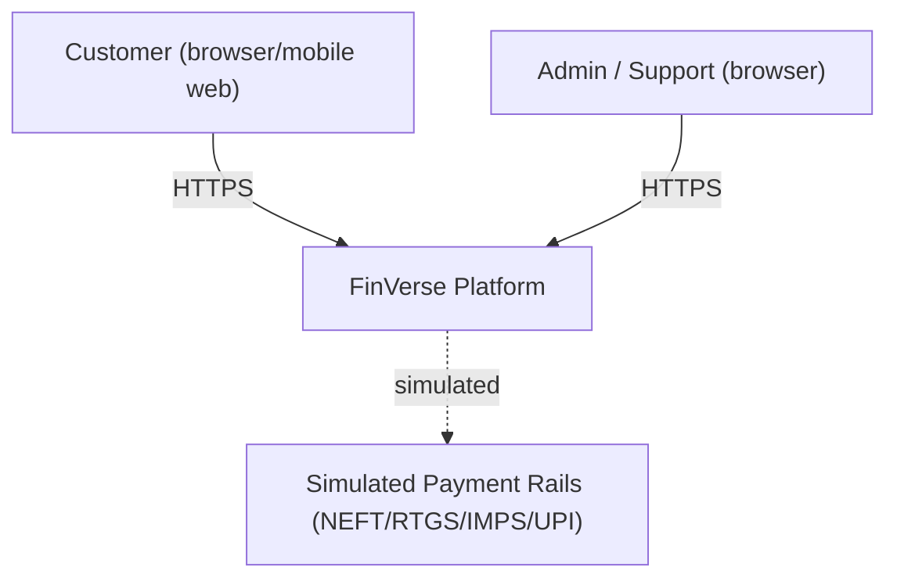
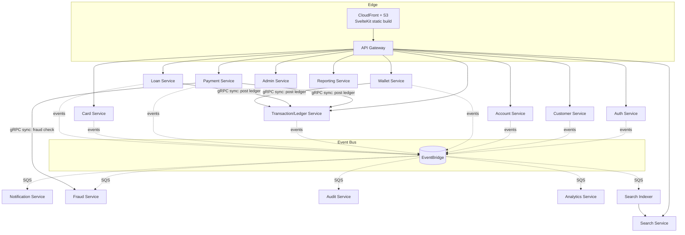
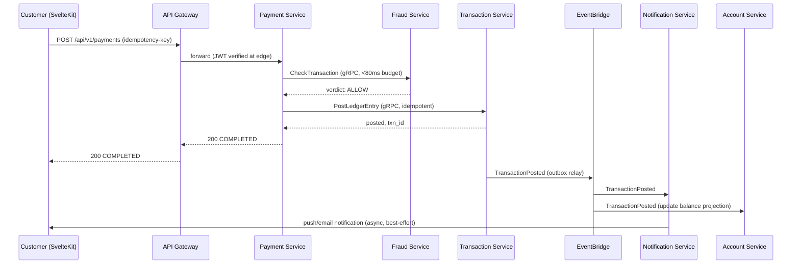
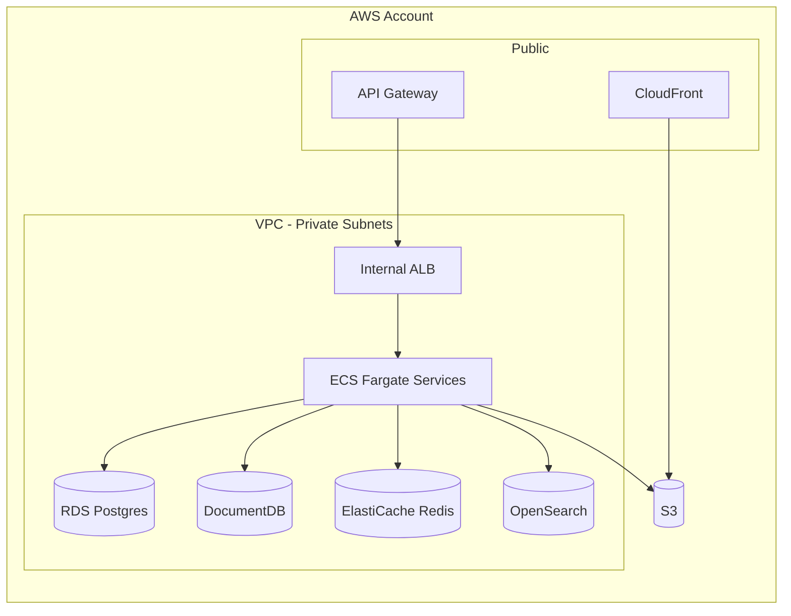

# 05 — Complete System Architecture

## 1. A note on the original sketch

The initial vision sketch drew the services as one vertical chain (Auth → Customer → Account → Wallet → Transfer → Card → Loan → Notification → Audit → Analytics → Admin → Fraud → Reporting → Search → Redis → Postgres → Mongo → S3). Read literally, that implies every request marches sequentially through all fifteen services — which is not how the system works and would be a poor design if it were. The diagrams below replace that sketch with the actual shape: a **hub-and-spoke edge** (Gateway → each service directly) plus an **event bus** for cross-service reactions. The vertical list was a service *catalog*, not a call graph — this document is the call graph.

## 2. C4: System Context

FinVerse has no real external dependencies (§6 of `01-product-vision.md`); "simulated rails" are internal to the Payment Service.

## 3. C4: Container view

Key reading: **the API Gateway talks to each service directly** — no service sits behind another on the synchronous request path except where a genuine synchronous dependency exists (Payment needs a fraud verdict and a ledger post *before* it can tell the customer "done"). Everything else — Notification, Fraud's async risk-score updates, Audit, Analytics, Search indexing — reacts to events after the fact.

## 4. Sync vs. async: the decision rule

Use this rule for every new inter-service interaction, not just the ones already diagrammed:

> **Call synchronously only if the caller cannot correctly respond to its own caller without the answer.** Everything else is an event.

Applied:
- Payment → Fraud (sync, gRPC): Payment cannot tell the customer "transfer accepted" without a risk verdict.
- Payment → Transaction (sync, gRPC): Payment cannot confirm completion without the ledger entry actually posting.
- Transaction → Notification (async, event): the customer already has their "completed" response; whether the SMS arrives in 1s or 10s doesn't change the payment outcome.
- Any service → Audit (async, event): audit must never be able to block or fail a business transaction (NFR-AVAIL-2).

## 5. CQRS: where it earns its keep

CQRS is applied selectively, not dogmatically, in two places:

1. **Account balance.** Writes go through Transaction Service's ledger (strongly consistent, normalized, optimized for correctness). Reads go through a denormalized balance projection maintained in Account Service, updated by consuming `TransactionPosted` events, optimized for the NFR-PERF-1 100ms read target. This is the textbook case: read and write have genuinely different shapes and different performance needs.
2. **Search and Analytics.** Both are pure read models built entirely from other services' events; they never accept a write that isn't itself a projection update.

CQRS is **not** applied inside services where the read and write models are the same shape (e.g. Customer profile) — that would add complexity with no payoff, which violates the no-speculative-abstraction rule in `00-master-ai-instructions.md §4.5`.

## 6. Key scenario walkthroughs

### 6.1 Fund transfer (customer A → customer B, same platform)

The customer gets their answer after two synchronous hops (Fraud, Transaction) — everything else happens after the response is already sent.

### 6.2 KYC approval fan-out

`KYCApproved` (published by Customer Service) is consumed independently by: Account Service (raises the customer's transaction tier/limits), Fraud Service (re-baselines risk profile), Notification Service (sends "you're verified" message), Audit Service (records the approval). None of these consumers know about each other; Customer Service knows about none of them. This is the payoff of the event bus — adding a sixth consumer later requires zero changes to Customer Service.

## 7. Resilience patterns used throughout

| Pattern | Where | Why |
|---|---|---|
| Idempotency keys | Every financial write endpoint | Safe client retries without double-posting (FR-X-1) |
| Transactional outbox | Every service that publishes events | Prevents the dual-write problem (DB commit succeeds, event publish fails, or vice versa) |
| Circuit breaker | Sync calls (Payment→Fraud, Payment→Transaction) | Fail fast instead of piling up requests against a degraded dependency |
| Retry with backoff + DLQ | All async consumers | Transient failures self-heal; permanent failures land somewhere visible instead of vanishing |
| Bulkheads (per-service SQS queues) | Event consumers | One slow consumer (e.g. Analytics) never backs up another (e.g. Notification) |
| Read replicas / projections | Account balance, Search, Analytics | Isolates read load from the write-critical ledger path |

## 8. Deployment topology (summary — full detail in `14-aws-infrastructure.md`)

## 9. Technology-to-purpose map

| Layer | Technology | Purpose |
|---|---|---|
| Frontend | SvelteKit, TypeScript, Tailwind, TanStack Query, Chart.js, Socket.io client | UI, data fetching/caching, charts, real-time balance/notification push |
| API layer | Go, Gin | HTTP handlers, request validation |
| Internal sync calls | gRPC + protobuf | Low-latency service-to-service calls on the critical path |
| Async messaging | EventBridge + SQS + DLQ | Domain event distribution, retries, failure isolation |
| Persistence | Postgres (per-service), MongoDB (Notification), OpenSearch (Search), ClickHouse (Analytics, later) | Fit-for-purpose storage per bounded context (`08-database-design.md`) |
| Caching | Redis / ElastiCache | Balance projection cache, rate limiting, fraud velocity counters |
| Observability | OpenTelemetry, Prometheus, Grafana, Jaeger, Loki | Tracing, metrics, dashboards, logs (`16-observability.md`) |
| IaC / deploy | Terraform, Docker, GitHub Actions, ECS Fargate | Reproducible infra and deploys (`14-aws-infrastructure.md`, `15-cicd-pipeline.md`) |

## 10. Architectural decision log (ADR summary)

| Decision | Alternative considered | Why this choice |
|---|---|---|
| Database-per-service (logical DB, shared RDS cluster initially) | Single shared DB | Preserves bounded-context ownership and independent schema evolution; shared cluster initially for cost, split later — documented tradeoff, not a compromise on ownership boundaries |
| EventBridge + SQS over a self-hosted broker (Kafka) | Kafka on ECS | Managed, lower ops burden for a solo-maintained project; SQS ordering/throughput is sufficient at this scale; Kafka's payoff (huge throughput, replay-heavy stream processing) doesn't materialize at portfolio scale |
| gRPC for the two hard-latency-budget internal calls, REST elsewhere | gRPC everywhere | REST/JSON is simpler to demo, debug, and document via OpenAPI for the majority of calls; gRPC reserved for where its latency/typing payoff actually matters |
| ECS Fargate over EKS | Kubernetes (EKS) | Lower operational overhead; the project's value is in service/domain design and AWS-native integration, not in demonstrating Kubernetes specifically |
| Outbox pattern over dual-write | Direct publish-after-commit | Removes the window where a crash between DB commit and event publish silently loses an event |

## 11. Traceability

Architecture decisions here are constrained by `04-non-functional-requirements.md` (performance/availability budgets) and implemented per-service in `07-microservice-specifications.md`. Any change to this document's call graph or resilience pattern set must be reflected in the affected service specs in the same change.
