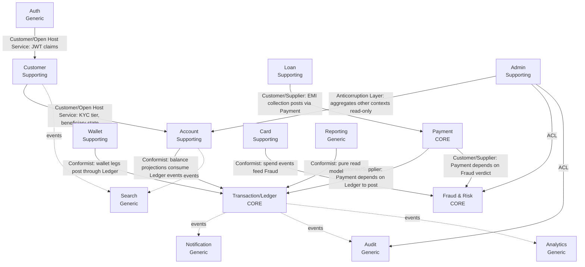

# 06 — Domain-Driven Design

## 1. Strategic classification

| Domain type | Bounded contexts | Rationale |
|---|---|---|
| **Core** (competitive differentiation, deserves the most design care) | Transaction/Ledger, Payment, Fraud & Risk | This is where correctness and judgment matter most; getting these wrong undermines the whole platform's credibility. |
| **Supporting** (necessary, domain-specific, but not the differentiator) | Customer, Account, Wallet, Card, Loan, Admin | Real business logic, but well-trodden patterns; correctness matters, novelty doesn't. |
| **Generic** (solved problems — use standard patterns, don't over-invest) | Auth, Notification, Audit, Analytics, Reporting, Search | Buy-or-build-standard territory; every fintech needs these, none of them is where FinVerse's story is told. |

This classification governs where extra design time goes: Transaction/Ledger and Fraud get the most scrutiny in `07-microservice-specifications.md`; Notification and Search get "solid and conventional."

## 2. Bounded contexts and ubiquitous language

Each bounded context owns a vocabulary. The same real-world word can mean different things in different contexts — that's expected and is why they're separate contexts, not a naming inconsistency to "fix."

### 2.1 Identity & Access (Auth Service)
- **User**: a login identity (email/phone + credential). Distinct from **Customer** — a User is who logs in; a Customer is who has money.
- **Session**: an access-token + refresh-token pair issued at login.
- **Scope**: a permission unit encoded in a JWT claim (e.g. `accounts:read`, `admin:fraud:resolve`).

### 2.2 Customer Management (Customer Service)
- **Customer**: a real-world person with a KYC status and profile, distinct from the User identity that authenticates as them.
- **KYC Tier**: 0 (unverified), 1 (basic), 2 (full) — governs what an account/customer is allowed to do elsewhere.
- **Beneficiary**: a payee a customer has registered for transfers; has its own verification state independent of the customer's own KYC tier.

### 2.3 Accounts (Account Service)
- **Account**: a ledger participant with a product type (savings/current/joint/virtual) owned by one or more Customers.
- **Available Balance** vs **Ledger Balance**: available = ledger balance minus holds (e.g. a pending card authorization); this distinction matters and is a common source of bugs if collapsed into one field.
- **Freeze**: a state that blocks debits, not the account's existence.

### 2.4 Wallet (Wallet Service)
- **Wallet**: a lightweight ledger participant, always backed by exactly one funding Account; "Wallet" in this context never means a physical or hardware wallet.

### 2.5 Transaction / Ledger (Transaction Service) — **core domain**
- **Transaction**: an atomic, balanced set of **Legs**.
- **Leg**: a single debit or credit against one ledger participant (Account, Wallet, or an internal clearing/suspense account). A Transaction's legs must sum to zero.
- **Posting**: the act of committing a Transaction; once posted, a Transaction is immutable.
- **Reversal**: a new Transaction whose legs are the exact inverse of an original, linked to it — "undo" always means "add the opposite," never "delete."
- **Daily Closing**: the batch process that snapshots balances and reconciles the day's postings.

This is the one context where "Transaction" is the ubiquitous-language anchor for the *entire platform* — every other context's "transaction" (a payment, a wallet transfer, an EMI collection) ultimately resolves to one or more Legs here. Other contexts should say "Payment," "Transfer," "EMI collection" for their own concepts and reserve "Transaction" for the ledger meaning, to avoid the word silently meaning three things across a conversation.

### 2.6 Payment (Payment Service) — **core domain**
- **Payment**: a customer-initiated instruction to move money via a Rail.
- **Rail**: the simulated transfer mechanism — NEFT, RTGS, IMPS, or UPI — each with its own timing/status semantics.
- **Standing Instruction**: a recurring Payment template.
- A Payment *becomes* a Transaction (in Transaction Service's sense) only once it clears fraud screening.

### 2.7 Card (Card Service)
- **Card**: a tokenized spending instrument linked to an Account, distinct from the Account itself; a Card can be frozen without freezing the Account.

### 2.8 Loan (Loan Service)
- **Loan**: an approved credit facility with a Schedule.
- **EMI**: one scheduled installment (principal + interest component).
- **Prepayment**: a customer-initiated extra payment that triggers Schedule recalculation, not a new Loan.

### 2.9 Fraud & Risk (Fraud Service) — **core domain**
- **Risk Score**: a running numeric assessment per Customer, updated by rule triggers.
- **Rule**: a configurable condition (velocity, limit, geo, failed-login) that can contribute to Risk Score or directly block an action.
- **Case**: an opened review item when a block/threshold is crossed, with its own lifecycle (open → reviewed → resolved).

### 2.10 Notification (Notification Service)
- **Notification**: a rendered, channel-specific message derived from a domain event — Notification Service has no concept of "why" something happened, only "what to send and where."

### 2.11 Audit (Audit Service)
- **Audit Record**: an immutable fact ("actor X did action Y to target Z at time T"). Audit never interprets or judges; it only records.

### 2.12 Admin (Admin Service)
- **Admin Action**: any state change initiated by an internal role rather than a customer — always paired with an Audit Record (FR-ADMIN-3).

### 2.13 Analytics / Reporting / Search
- These contexts have no independent domain vocabulary of their own — they are **read models** over other contexts' published language. This is intentional (§1: generic domains).

## 3. Context map

**Relationship legend:**
- **Open Host Service**: Auth and Customer expose a stable, documented contract (JWT claims; KYC/beneficiary state) that many others depend on — changing it is a big deal and requires versioning.
- **Customer/Supplier**: an explicit upstream/downstream with negotiated needs — e.g. Payment (customer) tells Fraud and Transaction (suppliers) what it needs from their APIs, and those services' teams (in a real org) would prioritize accordingly.
- **Conformist**: the downstream just accepts the upstream's model as-is (Account's balance projection has no independent opinion about what a "transaction" is — it takes Transaction Service's `TransactionPosted` event shape verbatim).
- **Anticorruption Layer (ACL)**: Admin Service deliberately does not expose other contexts' internal models directly to the admin UI; it translates them into admin-appropriate views so that, e.g., a schema change in Fraud Service doesn't ripple straight into the admin frontend.

## 4. Aggregates (representative, per core/supporting context)

| Context | Aggregate root | Invariant it enforces |
|---|---|---|
| Transaction | `Transaction` (with `Leg[]`) | Sum of leg amounts = 0; immutable once posted |
| Account | `Account` | Balance never goes below the product's configured floor (0 for savings, -overdraft_limit for current) |
| Wallet | `Wallet` | Balance never negative |
| Payment | `Payment` | Status transitions only along the documented lifecycle (§FR-PAY-6); cannot skip to COMPLETED without a Transaction reference |
| Loan | `Loan` (with `EMISchedule`) | Sum of remaining EMI principal always equals outstanding principal after any prepayment recalculation |
| Fraud | `Case` | Cannot be resolved without a recorded decision and actor |
| Customer | `Customer` (with `Beneficiary[]`) | KYC tier can only move forward through the documented review states, never skip states |

## 5. Domain events catalog

| Event | Published by | Consumed by |
|---|---|---|
| `UserRegistered`, `UserVerified` | Auth | Customer, Notification, Audit |
| `KYCApproved`, `KYCRejected` | Customer | Account, Fraud, Notification, Audit, Search |
| `BeneficiaryAdded` | Customer | Fraud, Notification, Audit |
| `AccountOpened`, `AccountFrozen`, `AccountUnfrozen` | Account | Notification, Audit, Search, Analytics |
| `InterestAccrued` | Account | Notification, Analytics |
| `WalletToppedUp`, `WalletTransferred` | Wallet | Notification, Audit, Analytics |
| `TransactionPosted`, `TransactionReversed` | Transaction | Account, Wallet, Notification, Audit, Analytics, Fraud |
| `DailyClosingCompleted` | Transaction | Reporting, Audit, Analytics |
| `PaymentInitiated`, `PaymentCompleted`, `PaymentFailed` | Payment | Notification, Audit, Analytics |
| `CardIssued`, `CardFrozen`, `CardBlocked` | Card | Notification, Audit, Fraud |
| `LoanApproved`, `LoanRejected`, `EMIPaid`, `EMIMissed` | Loan | Notification, Audit, Fraud, Analytics |
| `FraudCaseOpened`, `FraudCaseResolved`, `RiskScoreUpdated` | Fraud | Notification, Audit, Admin |

Every event carries: `event_id` (UUID, dedupe key), `occurred_at`, `trace_id` (propagated from the originating request), `source_service`, `version`, and a payload matching the schema registered in `09-api-standards.md §Event Schemas`.

## 6. Anti-corruption boundaries worth calling out explicitly

- **Admin Service never queries other services' databases directly.** It calls their APIs or reads from Search/Analytics projections. This is what keeps "Admin" from silently becoming a god-service that knows every other context's internals.
- **Fraud's Risk Score is not shared as a raw number outside Fraud Service.** Other services get a verdict (`ALLOW`/`BLOCK`/`REVIEW`), not the score itself — this keeps the scoring model free to change without becoming a public contract.

## 7. Traceability

Bounded contexts here map 1:1 to services in `07-microservice-specifications.md`. The event catalog in §5 is the authoritative list that `09-api-standards.md §Event Schemas` defines structurally.
