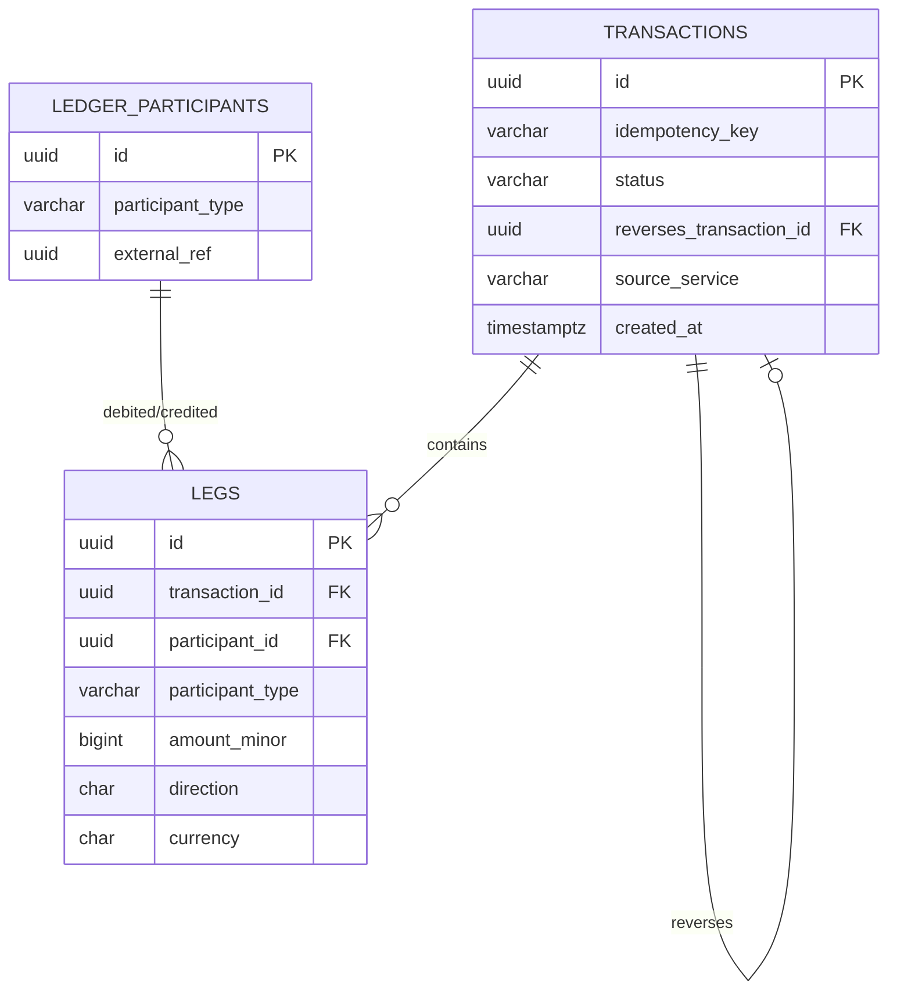

# 08 — Database Design

## 1. Ownership rule

**No service ever connects to another service's database.** All cross-service data access is via API call (sync) or domain event (async). This is the one rule in this document that is never relaxed for convenience — a "quick join across services" is always a sign the data should be projected locally via an event consumer instead.

## 2. Storage engine per service (recap from `06-domain-driven-design.md` / `07-microservice-specifications.md`)

| Service | Engine | Why |
|---|---|---|
| Auth | Postgres | Relational integrity for credentials/tokens; ACID needed for refresh-token rotation |
| Customer | Postgres | Relational profile + beneficiary data; documents in S3 |
| Account | Postgres | Strong consistency for account metadata; balance projection cached in Redis |
| Wallet | Postgres | Same pattern as Account |
| Transaction/Ledger | Postgres | Strict ACID + CHECK constraints for the double-entry invariant — non-negotiable |
| Payment | Postgres | Relational; orchestration state |
| Card | Postgres | Small, relational |
| Loan | Postgres | Relational, amortization schedules |
| Fraud | Postgres + Redis | Postgres for rules/cases (durable); Redis for velocity counters (needs sub-ms sliding-window ops) |
| Notification | MongoDB | Schema-per-channel documents; no relational integrity needed |
| Audit | Postgres | Append-only, partitioned; relational query needs (filter by actor/date/type) |
| Admin | Postgres | Small, relational (admin users/roles/approvals only) |
| Analytics | ClickHouse | Columnar, built for aggregate queries over large event volumes |
| Reporting | Postgres (metadata) + S3 (output) | Report *requests* are relational; report *output* is a blob |
| Search | OpenSearch | Full-text/fuzzy search, not a system of record |

## 3. Money representation (applies to every schema below)

All monetary columns are `BIGINT` storing **minor units** (paise), never `FLOAT`/`DOUBLE`, per NFR-DATA-4. A `currency` column (`CHAR(3)`, ISO 4217, default `INR`) accompanies every monetary column even though the platform is single-currency today — this avoids a breaking migration if multi-currency is ever added.

## 4. Transaction / Ledger Service — the schema that matters most



Key DDL-level rules (enforced by the database, not just application code):

```sql
CREATE TABLE transactions (
    id                       UUID PRIMARY KEY DEFAULT gen_random_uuid(),
    idempotency_key          VARCHAR(128) NOT NULL,
    status                   VARCHAR(16)  NOT NULL DEFAULT 'POSTED'
                              CHECK (status IN ('POSTED','REVERSED')),
    reverses_transaction_id  UUID REFERENCES transactions(id),
    source_service           VARCHAR(64)  NOT NULL,
    created_at               TIMESTAMPTZ  NOT NULL DEFAULT now(),
    UNIQUE (source_service, idempotency_key)
);

CREATE TABLE legs (
    id               UUID PRIMARY KEY DEFAULT gen_random_uuid(),
    transaction_id   UUID NOT NULL REFERENCES transactions(id),
    participant_id   UUID NOT NULL,
    participant_type VARCHAR(32) NOT NULL, -- 'ACCOUNT' | 'WALLET' | 'SUSPENSE'
    amount_minor     BIGINT NOT NULL CHECK (amount_minor > 0),
    direction        CHAR(1) NOT NULL CHECK (direction IN ('D','C')),
    currency         CHAR(3) NOT NULL DEFAULT 'INR'
);

-- Enforced via an AFTER INSERT statement-level trigger (deferred to end of
-- transaction) rather than a plain CHECK, because the invariant spans
-- multiple rows: SUM(CASE WHEN direction='D' THEN amount_minor ELSE -amount_minor END) = 0
-- per transaction_id, per currency.
CREATE CONSTRAINT TRIGGER trg_legs_balance
    AFTER INSERT ON legs
    DEFERRABLE INITIALLY DEFERRED
    FOR EACH ROW EXECUTE FUNCTION check_transaction_balances();
```

`transactions` is immutable at the application-role grant level (no `UPDATE`/`DELETE` GRANT for the service's DB role except the narrow, audited path that sets `status = 'REVERSED'` when a reversal is posted). Every correction is a new row in `transactions`/`legs` referencing the original via `reverses_transaction_id` — this is BR-07 and FR-TXN-4 enforced structurally, not just by convention.

`legs` is partitioned by month on `transaction_id`'s creation time once volume warrants it (not required for local/dev, called out here so it's a deliberate decision in `19-implementation-roadmap.md` Phase 5, not a scramble later).

The **transactional outbox** table lives in this same database so the event publish is committed atomically with the ledger write:

```sql
CREATE TABLE outbox (
    id            UUID PRIMARY KEY DEFAULT gen_random_uuid(),
    event_type    VARCHAR(64) NOT NULL,
    payload       JSONB NOT NULL,
    created_at    TIMESTAMPTZ NOT NULL DEFAULT now(),
    published_at  TIMESTAMPTZ
);
```
A relay process (polling or CDC via Debezium — see `05-system-architecture.md §7`) publishes unpublished rows to EventBridge and marks `published_at`.

## 5. Account Service

```sql
CREATE TABLE accounts (
    id              UUID PRIMARY KEY DEFAULT gen_random_uuid(),
    customer_id     UUID NOT NULL,              -- reference to Customer Service, not a FK (different DB)
    account_number  VARCHAR(20) NOT NULL UNIQUE,
    product_type    VARCHAR(16) NOT NULL CHECK (product_type IN ('SAVINGS','CURRENT','JOINT','VIRTUAL')),
    status          VARCHAR(16) NOT NULL DEFAULT 'ACTIVE' CHECK (status IN ('ACTIVE','FROZEN','CLOSED')),
    overdraft_limit_minor BIGINT NOT NULL DEFAULT 0,
    created_at      TIMESTAMPTZ NOT NULL DEFAULT now()
);

CREATE TABLE account_holders (
    account_id   UUID NOT NULL REFERENCES accounts(id),
    customer_id  UUID NOT NULL,
    role         VARCHAR(16) NOT NULL DEFAULT 'OWNER' CHECK (role IN ('OWNER','JOINT_HOLDER')),
    PRIMARY KEY (account_id, customer_id)
);

-- CQRS read-side projection, rebuilt from Transaction Service's events
CREATE TABLE balance_projection (
    account_id        UUID PRIMARY KEY REFERENCES accounts(id),
    ledger_balance_minor    BIGINT NOT NULL DEFAULT 0,
    available_balance_minor BIGINT NOT NULL DEFAULT 0,
    last_transaction_id     UUID,
    updated_at              TIMESTAMPTZ NOT NULL DEFAULT now()
);
```
`balance_projection` is additionally cached in Redis as `balance:{account_id}` with a short TTL + explicit invalidation on `TransactionPosted` consumption — this is the concrete mechanism behind NFR-PERF-1.

## 6. Customer Service

```sql
CREATE TABLE customers (
    id              UUID PRIMARY KEY DEFAULT gen_random_uuid(),
    user_id         UUID NOT NULL UNIQUE,   -- reference to Auth Service's User
    full_name       VARCHAR(128) NOT NULL,
    dob             DATE NOT NULL,
    pan_encrypted   BYTEA NOT NULL,         -- AES-256-GCM, see 11-security-standards.md
    pan_masked      VARCHAR(16) NOT NULL,   -- e.g. "ABCXX1234X" for display/logging
    kyc_tier        SMALLINT NOT NULL DEFAULT 0 CHECK (kyc_tier IN (0,1,2)),
    kyc_status      VARCHAR(16) NOT NULL DEFAULT 'PENDING'
                    CHECK (kyc_status IN ('PENDING','UNDER_REVIEW','APPROVED','REJECTED')),
    created_at      TIMESTAMPTZ NOT NULL DEFAULT now(),
    updated_at      TIMESTAMPTZ NOT NULL DEFAULT now()
);

CREATE TABLE kyc_documents_meta (
    id           UUID PRIMARY KEY DEFAULT gen_random_uuid(),
    customer_id  UUID NOT NULL REFERENCES customers(id),
    doc_type     VARCHAR(32) NOT NULL,
    storage_key  VARCHAR(256) NOT NULL, -- local filesystem path in Phase 1-3 (behind a Storage
                                         -- interface), an S3 key once Phase 4 lands — same
                                         -- column, renamed from the original "s3_key" sketch
                                         -- so it doesn't lie about what it holds today
    uploaded_at  TIMESTAMPTZ NOT NULL DEFAULT now()
);

CREATE TABLE beneficiaries (
    id           UUID PRIMARY KEY DEFAULT gen_random_uuid(),
    customer_id  UUID NOT NULL REFERENCES customers(id),
    name         VARCHAR(128) NOT NULL,
    account_ref  VARCHAR(64) NOT NULL,
    verified     BOOLEAN NOT NULL DEFAULT FALSE,
    created_at   TIMESTAMPTZ NOT NULL DEFAULT now()
);
```
`pan_encrypted` / `pan_masked` split is deliberate: nothing that displays a customer's PAN in a UI or log ever needs to decrypt it — see NFR-COMP-3 and `11-security-standards.md §Field-Level Encryption`.

## 7. Auth Service

```sql
CREATE TABLE users (
    id              UUID PRIMARY KEY DEFAULT gen_random_uuid(),
    email           VARCHAR(256) NOT NULL UNIQUE,
    phone           VARCHAR(20)  UNIQUE,
    password_hash   VARCHAR(256) NOT NULL,  -- bcrypt/argon2id, see 11-security-standards.md
    role            VARCHAR(16) NOT NULL DEFAULT 'customer'
                    CHECK (role IN ('customer','support','fraud_analyst','auditor','admin','super_admin')),
                    -- persisted source for the JWT `role` claim (10-authentication-authorization.md §2.1);
                    -- added during Phase 1 implementation, tracked back into this doc per 00-master-ai-instructions.md §3
    email_verified  BOOLEAN NOT NULL DEFAULT FALSE,
    status          VARCHAR(16) NOT NULL DEFAULT 'ACTIVE' CHECK (status IN ('ACTIVE','LOCKED','DISABLED')),
    failed_login_count SMALLINT NOT NULL DEFAULT 0,
    locked_until    TIMESTAMPTZ,            -- FR-AUTH-9 lockout expiry
    created_at      TIMESTAMPTZ NOT NULL DEFAULT now(),
    updated_at      TIMESTAMPTZ NOT NULL DEFAULT now()
);

CREATE TABLE refresh_tokens (
    id            UUID PRIMARY KEY DEFAULT gen_random_uuid(),
    user_id       UUID NOT NULL REFERENCES users(id),
    token_hash    VARCHAR(128) NOT NULL UNIQUE, -- SHA-256 of the actual token; raw token never stored
    family_id     UUID NOT NULL,   -- rotation family; reuse of a revoked token revokes the whole family
    revoked       BOOLEAN NOT NULL DEFAULT FALSE,
    expires_at    TIMESTAMPTZ NOT NULL,
    created_at    TIMESTAMPTZ NOT NULL DEFAULT now()
);

CREATE TABLE email_verification_tokens (
    id            UUID PRIMARY KEY DEFAULT gen_random_uuid(),
    user_id       UUID NOT NULL REFERENCES users(id),
    token_hash    VARCHAR(128) NOT NULL UNIQUE,
    expires_at    TIMESTAMPTZ NOT NULL,
    used_at       TIMESTAMPTZ,
    created_at    TIMESTAMPTZ NOT NULL DEFAULT now()
);

CREATE TABLE password_reset_tokens (
    id            UUID PRIMARY KEY DEFAULT gen_random_uuid(),
    user_id       UUID NOT NULL REFERENCES users(id),
    token_hash    VARCHAR(128) NOT NULL UNIQUE,
    expires_at    TIMESTAMPTZ NOT NULL,
    used_at       TIMESTAMPTZ,
    created_at    TIMESTAMPTZ NOT NULL DEFAULT now()
);

-- mfa_secrets ships when MFA enrollment is implemented (deferred within
-- Phase 1 — see 19-implementation-roadmap.md); table shape unchanged from
-- the original design below.
CREATE TABLE mfa_secrets (
    user_id       UUID PRIMARY KEY REFERENCES users(id),
    totp_secret_encrypted BYTEA NOT NULL,
    enabled       BOOLEAN NOT NULL DEFAULT FALSE
);
```

## 8. Payment Service

```sql
CREATE TABLE payments (
    id             UUID PRIMARY KEY DEFAULT gen_random_uuid(),
    idempotency_key VARCHAR(128) NOT NULL,
    from_account_id UUID NOT NULL,
    to_reference    VARCHAR(64) NOT NULL,  -- internal account/wallet id or external simulated rail reference
    rail            VARCHAR(8) NOT NULL CHECK (rail IN ('NEFT','RTGS','IMPS','UPI','INTERNAL')),
    amount_minor    BIGINT NOT NULL CHECK (amount_minor > 0),
    status          VARCHAR(16) NOT NULL DEFAULT 'INITIATED'
                    CHECK (status IN ('INITIATED','PROCESSING','COMPLETED','FAILED','REVERSED')),
    transaction_id  UUID,  -- set once Transaction Service confirms posting
    created_at      TIMESTAMPTZ NOT NULL DEFAULT now(),
    UNIQUE (from_account_id, idempotency_key)
);

CREATE TABLE standing_instructions (
    id             UUID PRIMARY KEY DEFAULT gen_random_uuid(),
    from_account_id UUID NOT NULL,
    to_reference    VARCHAR(64) NOT NULL,
    amount_minor    BIGINT NOT NULL CHECK (amount_minor > 0),
    frequency       VARCHAR(16) NOT NULL CHECK (frequency IN ('DAILY','WEEKLY','MONTHLY')),
    next_run_at     TIMESTAMPTZ NOT NULL,
    status          VARCHAR(16) NOT NULL DEFAULT 'ACTIVE' CHECK (status IN ('ACTIVE','PAUSED','CANCELLED'))
);
```

## 9. Loan Service

```sql
CREATE TABLE loans (
    id              UUID PRIMARY KEY DEFAULT gen_random_uuid(),
    customer_id     UUID NOT NULL,
    principal_minor BIGINT NOT NULL CHECK (principal_minor > 0),
    annual_rate_bps INTEGER NOT NULL,       -- basis points, e.g. 1050 = 10.50%
    tenure_months   SMALLINT NOT NULL,
    status          VARCHAR(16) NOT NULL DEFAULT 'PENDING'
                    CHECK (status IN ('PENDING','APPROVED','REJECTED','ACTIVE','CLOSED')),
    created_at      TIMESTAMPTZ NOT NULL DEFAULT now()
);

CREATE TABLE emi_schedules (
    id               UUID PRIMARY KEY DEFAULT gen_random_uuid(),
    loan_id          UUID NOT NULL REFERENCES loans(id),
    installment_no   SMALLINT NOT NULL,
    due_date         DATE NOT NULL,
    principal_minor  BIGINT NOT NULL,
    interest_minor   BIGINT NOT NULL,
    status           VARCHAR(16) NOT NULL DEFAULT 'DUE' CHECK (status IN ('DUE','PAID','MISSED','WAIVED')),
    UNIQUE (loan_id, installment_no)
);
```

## 10. Fraud Service

```sql
CREATE TABLE rules (
    id          UUID PRIMARY KEY DEFAULT gen_random_uuid(),
    name        VARCHAR(64) NOT NULL UNIQUE,
    rule_type   VARCHAR(24) NOT NULL CHECK (rule_type IN ('VELOCITY','DAILY_LIMIT','GEO','FAILED_LOGIN')),
    config      JSONB NOT NULL,   -- e.g. {"max_count": 5, "window_seconds": 300}
    enabled     BOOLEAN NOT NULL DEFAULT TRUE
);

CREATE TABLE cases (
    id            UUID PRIMARY KEY DEFAULT gen_random_uuid(),
    customer_id   UUID NOT NULL,
    triggered_by  UUID REFERENCES rules(id),
    status        VARCHAR(16) NOT NULL DEFAULT 'OPEN' CHECK (status IN ('OPEN','REVIEWED','RESOLVED')),
    decision      VARCHAR(16) CHECK (decision IN ('APPROVE','REJECT')),
    decided_by    UUID,
    created_at    TIMESTAMPTZ NOT NULL DEFAULT now()
);

CREATE TABLE risk_scores (
    customer_id  UUID PRIMARY KEY,
    score        INTEGER NOT NULL DEFAULT 0,
    updated_at   TIMESTAMPTZ NOT NULL DEFAULT now()
);
```
Redis keys (velocity/rate, not durable): `fraud:velocity:{customer_id}:{window}` (sorted set, timestamps as scores), TTL matched to the rule's window.

## 11. Audit Service

```sql
CREATE TABLE audit_records (
    id            UUID PRIMARY KEY DEFAULT gen_random_uuid(),
    actor_type    VARCHAR(16) NOT NULL CHECK (actor_type IN ('CUSTOMER','ADMIN','SYSTEM')),
    actor_id      UUID,
    action        VARCHAR(64) NOT NULL,
    target_type   VARCHAR(32) NOT NULL,
    target_id     UUID,
    before_state  JSONB,
    after_state   JSONB,
    trace_id      VARCHAR(64),
    occurred_at   TIMESTAMPTZ NOT NULL DEFAULT now()
) PARTITION BY RANGE (occurred_at);

-- application DB role grants: SELECT, INSERT only. No UPDATE, no DELETE. Ever.
REVOKE UPDATE, DELETE ON audit_records FROM finverse_audit_app;
```

## 12. Notification Service (MongoDB — document shape, not DDL)

```json
{
  "_id": "ObjectId",
  "customer_id": "uuid",
  "event_id": "uuid",          // dedupe key, unique index
  "channel": "EMAIL|SMS|PUSH|WEBHOOK",
  "template": "payment_completed",
  "payload": { "...": "channel-specific rendered content" },
  "status": "PENDING|SENT|FAILED|DEAD_LETTERED",
  "attempts": 0,
  "created_at": "ISODate",
  "last_attempt_at": "ISODate"
}
```
Unique index on `event_id + channel` enforces FR-NOTIF-5 (idempotent consumption) at the storage layer.

## 13. Analytics (ClickHouse — table sketch)

```sql
CREATE TABLE transaction_events (
    event_time DateTime,
    transaction_id UUID,
    account_id UUID,
    amount_minor Int64,
    direction Enum8('D'=1,'C'=2),
    source_service String
) ENGINE = MergeTree()
ORDER BY (event_time, account_id);
```
Populated purely from consumed events; never queried by any write path (FR-ANALYTICS-2).

## 14. Search (OpenSearch — index sketch)

Indices: `customers` (name, PAN-masked, tier), `accounts` (account number, holder name, status), `transactions` (reference, amount, date, parties) — all populated by an async indexer consumer, never written to synchronously by a customer-facing request.

## 15. Migration strategy

- Every service manages its own migrations independently (e.g. `golang-migrate`), versioned in that service's directory under `db/migrations/`.
- Migrations are forward-only in shared environments (staging/prod); a bad migration is fixed with a new forward migration, not a manual rollback against a live database.
- No migration may be applied to staging/prod outside CI/CD (`15-cicd-pipeline.md §Migration Gate`).

## 16. Indexing baseline

Every table gets an index on: its foreign-key-shaped reference columns used in lookups (e.g. `accounts.customer_id`, `legs.transaction_id`), any column used in a `WHERE` on a hot path (e.g. `payments.idempotency_key`, `refresh_tokens.token_hash`), and any column used for admin/audit filtering (e.g. `audit_records.actor_id`, `audit_records.occurred_at`).

## 17. Traceability

Every table here backs a `FR-*` requirement in `03-functional-requirements.md` and belongs to the service defined in `07-microservice-specifications.md`. Request/response shapes that expose these fields externally are defined in `09-api-standards.md`.
