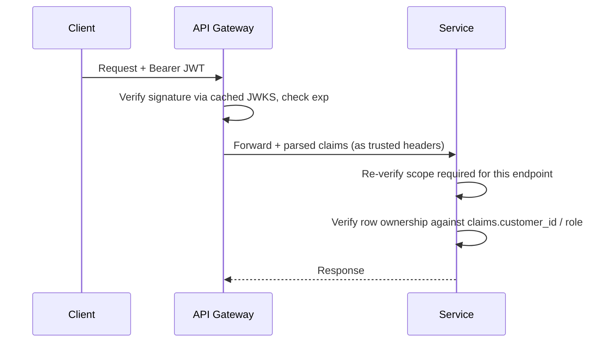

# 10 — Authentication & Authorization

## 1. Identity model

Three distinct identity concepts, deliberately kept separate (see `06-domain-driven-design.md §2.1–2.2`):

- **User** (Auth Service) — a login identity: email/phone + credential + MFA state. The thing that authenticates.
- **Customer** (Customer Service) — a real-world person with a KYC status, linked 1:1 to a User via `customer.user_id`. The thing that owns money.
- **Admin User** (Admin Service) — an internal operator identity, also backed by a User for login, but carrying admin-specific roles instead of a KYC/Customer profile.

A single Auth Service issues tokens for all three; what differs is the **role/scope claims** the token carries, not the login mechanism.

## 2. Token model

| Token | Lifetime | Storage | Purpose |
|---|---|---|---|
| Access token (JWT) | 15 minutes | Memory / short-lived client storage, never `localStorage` for the raw token (XSS exposure) — held in memory and refreshed silently | Authenticates API calls |
| Refresh token | 7 days (customer), 24 hours (admin — stricter, per §6) | HttpOnly, Secure, SameSite=Strict cookie | Obtains new access tokens without re-login |
| OTP (step-up) | 5 minutes, single-use | Server-side (Auth Service `otp_codes` table) | One-time proof for a specific high-risk action |

### 2.1 JWT claims

```json
{
  "sub": "user-uuid",
  "customer_id": "customer-uuid",
  "role": "customer",
  "scopes": ["accounts:read", "payments:write", "cards:manage"],
  "kyc_tier": 2,
  "mfa": true,
  "iat": 1737000000,
  "exp": 1737000900,
  "iss": "https://auth.finverse.dev",
  "aud": "finverse-api",
  "jti": "token-uuid"
}
```
- `scopes` drive RBAC checks (§3); `role` is informational/UI-facing, never itself the authorization decision — always check scopes, not role name, in code.
- `kyc_tier` is embedded so downstream services (Payment, Account) can enforce tier-gated limits (BR-03) without an extra call to Customer Service on every request.
- `jti` is the token's unique ID, used for targeted revocation (§4).

### 2.2 Refresh token rotation

Each refresh call: validate the presented token → issue a new access token **and** a new refresh token → mark the old refresh token `revoked = true`, both sharing the same `family_id` (`08-database-design.md §7`). If a revoked token is ever presented again (replay — meaning a token was stolen and both the thief and the legitimate user tried to use it), the **entire family** is revoked and the user is forced to re-authenticate. This is FR-AUTH-6, and it's the mechanism that turns "a refresh token leaked" into "one detected incident" instead of "silent indefinite access."

### 2.3 Revocation

- `POST /auth/logout` revokes the presented refresh token only.
- `POST /auth/logout-all` revokes every refresh token for the user (`family_id` irrelevant — all rows for `user_id`).
- Access tokens are not individually revocable (JWTs are stateless by design) — this is why their lifetime is short (15 min). A security incident response that needs to cut off an access token immediately blocks at the API Gateway via a short-lived `jti` denylist in Redis, used only for emergency revocation, not routine logout.

## 3. RBAC model

### 3.1 Roles

| Role | Who | Notes |
|---|---|---|
| `customer` | Any verified retail user | Scoped strictly to their own resources |
| `support` | Internal support staff | Read-heavy; can view but not change money-moving state |
| `fraud_analyst` | Internal fraud reviewer | Can resolve fraud cases; cannot directly move money |
| `auditor` | Internal/compliance | Read-only, broadest read scope (needs to see everything), zero write scope |
| `admin` | Internal ops | Can freeze/unfreeze, adjust limits, resolve cases |
| `super_admin` | Platform owner | Everything `admin` has, plus role/permission management itself |

### 3.2 Scope catalog (representative)

| Scope | Grants |
|---|---|
| `accounts:read` | Read own (customer) or any (internal roles, per row-level rule in §3.3) account |
| `accounts:manage` | Freeze/unfreeze, open, close |
| `wallets:read` | Read own wallet balance |
| `wallets:manage` | Provision a wallet, top up, wallet-to-wallet transfer |
| `payments:read` | Poll a payment's status |
| `payments:write` | Initiate a payment/transfer |
| `cards:manage` | Issue/freeze/block a card |
| `loans:apply` | Submit a loan application |
| `fraud:cases:review` | View and resolve fraud cases |
| `admin:limits:adjust` | Change configured limits/thresholds |
| `audit:read` | Query audit records |

### 3.3 Ownership rule (row-level authorization)

Scopes answer "can this role do this *kind* of thing at all"; ownership answers "on *which* rows." A `customer` role with `accounts:read` may only read accounts where they are a listed `account_holder` (`08-database-design.md §5`) — this check happens in every service's handler, not just at the gateway, because the gateway cannot know row ownership. **Every handler that returns or mutates a specific resource must verify ownership or an internal-role bypass before executing business logic** — this is FR NFR-SEC-4 made concrete, and it is the single most important authorization rule in the system: a scope check alone is not enough.

## 4. Where enforcement happens



- **API Gateway**: signature validity, expiry, malformed-token rejection. This is a fast-fail layer, not the sole authority.
- **Every service**: scope check (does this endpoint's required scope appear in the token) + ownership check (§3.3). Services never trust the gateway alone — defense in depth, and necessary anyway because ownership can't be evaluated at the gateway.

## 5. MFA and step-up OTP

- **MFA (TOTP, RFC 6238)**: optional-but-encouraged for customers, **mandatory** for `admin`/`super_admin`/`fraud_analyst` roles (§6). Enrollment via `POST /auth/mfa/enable`, returning a QR-encodable secret; verified by a subsequent TOTP code before being marked active.
- **Step-up OTP**: independent of MFA — triggered per-action by the calling service (Payment for high-value transfers per FR-PAY-4, Customer for adding a new beneficiary) via `POST /auth/otp/request` (delivers via email/SMS) then `POST /auth/otp/verify`, returning a short-lived, single-use **step-up token** the original action's request must include. This keeps "is this login legitimate" (MFA) and "is this specific action authorized right now" (OTP) as separate concerns, since a customer might have a fully legitimate, MFA'd session and still need to prove intent for a large transfer.

## 6. Admin authentication is stricter than customer authentication

Because an admin identity can affect other people's money and data:
- MFA is mandatory, not optional, for every internal role.
- Refresh token lifetime is 24 hours, not 7 days.
- Every admin login and every scope-gated admin action is written to Audit (FR-ADMIN-3) — this is enforced by having Admin Service's handlers call Audit synchronously-enough to guarantee ordering before responding success (see `07-microservice-specifications.md §13`), not just fire-and-forget.
- Admin sessions are tied to a device fingerprint; a login from a new device/location triggers step-up OTP even mid-session-lifetime.

## 7. Service-to-service authentication

- Internal gRPC calls (§3 of `09-api-standards.md`) run inside the VPC over TLS, authenticated via mTLS using certificates issued per-service (short-lived, rotated by the service mesh/ECS task role — detail in `14-aws-infrastructure.md §IAM`). A calling service's identity (not a customer's) is what's authenticated on this hop; the original customer's claims are passed through as a signed, forwarded context (not re-derived), so Fraud/Transaction can still apply ownership-adjacent logic if ever needed without a second round-trip to Auth.
- No service-to-service call is ever unauthenticated, even inside the private VPC — network-level trust (correctly) is not treated as identity.

## 8. Password and credential policy

Full detail in `11-security-standards.md §Credential Handling`; summarized here because it's part of the auth contract: minimum 12 characters, checked against a breached-password list at registration, hashed with Argon2id (never bcrypt-only, never plaintext, never a reversible cipher), rate-limited login attempts (FR-AUTH-9).

## 9. Traceability

FR-AUTH-1 through FR-AUTH-12 in `03-functional-requirements.md` are implemented per this document. RBAC scopes referenced here are enforced per-endpoint as documented in each service's OpenAPI spec (`09-api-standards.md §2.10`).
