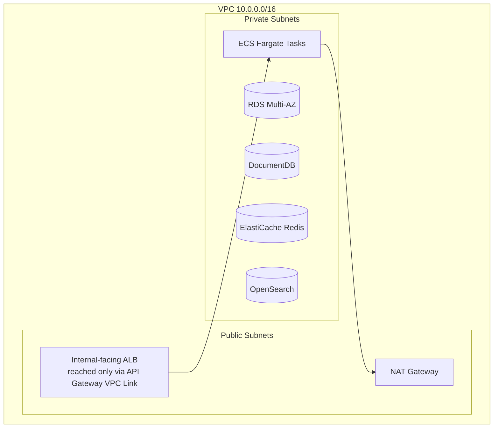

# 14 — AWS Infrastructure

## 1. Account and environment strategy

Single AWS account (cost/complexity appropriate for a solo-maintained project), three logical environments distinguished by VPC, resource naming/tagging, and Terraform workspace: `dev`, `staging`, `prod`. If AWS Organizations/multi-account ever becomes worth the overhead (e.g. the project grows collaborators), that's a documented future decision, not a Phase 1–6 requirement.

Every resource is tagged: `Environment`, `Service`, `ManagedBy=terraform`, `Project=finverse` — this is what makes cost allocation and the cost dashboard (§9) possible.

## 2. Networking

- One VPC per environment, 3 AZs for staging/prod (2 for dev, cost-saving), private subnets for all compute and data, public subnets hold only the NAT Gateway and the internal ALB's ENIs.
- No security group ever allows `0.0.0.0/0` inbound except the ALB's controlled listener, itself only reachable through API Gateway's VPC Link — the internet never talks to ECS directly (`11-security-standards.md §7`).
- VPC endpoints (S3, Secrets Manager, ECR, CloudWatch Logs) are used so ECS tasks don't need NAT egress for AWS API calls — reduces both NAT data-transfer cost and attack surface.

## 3. Compute — ECS Fargate

- One ECS cluster per environment. One ECS service + task definition per microservice (15 services), each with its own task role (§8).
- Task sizing starts minimal (0.25 vCPU / 512MB) per service in dev/staging; sized up per service only where load testing (`17-testing-strategy.md §Load Testing`) shows a need — no service gets provisioned for hypothetical scale it hasn't demonstrated needing (NFR-COST-2).
- Auto-scaling policies target ALB request count per task; dev environment services are additionally scheduled to scale to **zero** outside active development/demo hours via a scheduled Application Auto Scaling action (§9).
- Service discovery via AWS Cloud Map (ECS Service Connect) for internal gRPC calls — services address each other by logical name (`fraud-service.finverse.local`), not hardcoded IPs/ALB DNS.

## 4. Edge — CloudFront + API Gateway

- **CloudFront + S3**: serves the built SvelteKit static assets; cache-busted via content-hashed filenames, with a short TTL on `index.html` and long TTL on hashed assets.
- **API Gateway (HTTP API)**: the single entry point for all REST traffic, terminating TLS, validating JWTs at the edge via a Lambda authorizer or native JWT authorizer pointed at Auth Service's JWKS endpoint (`10-authentication-authorization.md §4`), then forwarding to the internal ALB via VPC Link.
- Custom domain (`api.finverse.dev`, `app.finverse.dev` or similar) with ACM-issued TLS certificates, one per environment subdomain (`staging-api.finverse.dev`, etc.).

## 5. Data stores

| Store | Service | AWS resource | Notes |
|---|---|---|---|
| Postgres | Auth, Customer, Account, Wallet, Transaction, Payment, Card, Loan, Fraud, Audit, Admin, Reporting(meta) | RDS for PostgreSQL, Multi-AZ in staging/prod | One RDS instance per environment hosting a separate logical database per service initially (cost-driven); split to dedicated instances per service is a documented, deferred scaling step (`05-system-architecture.md §10`), triggered by an actual measured contention issue, not preemptively |
| MongoDB-compatible | Notification | Amazon DocumentDB | Single-instance in dev, replica set in staging/prod |
| Cache / counters | Fraud, balance projections | ElastiCache for Redis | Single node dev, replication group staging/prod |
| Search | Search Service | Amazon OpenSearch Service | Single-node dev, 3-node staging/prod |
| Analytics | Analytics Service | ClickHouse on ECS (self-managed; no first-party AWS managed ClickHouse) | Phase 6, only stood up when Analytics is actually built |
| Object storage | KYC docs, statements, report output, frontend static assets | S3 (separate buckets per concern: `finverse-<env>-documents`, `finverse-<env>-reports`, `finverse-<env>-frontend`) | Documents bucket has no public access ever; access via presigned URLs only |

## 6. Eventing

- **EventBridge**: one custom event bus per environment (`finverse-<env>-domain-events`), rules per `eventType` per `09-api-standards.md §4.3`.
- **SQS**: one queue + one DLQ per consuming service per event type it cares about (or a single queue per service subscribed to multiple rules, if the service handles multiple event types through one worker — a per-service implementation choice, not a platform rule), redrive policy max 5 receives before DLQ.
- **CloudWatch Alarm** on every DLQ's `ApproximateNumberOfMessagesVisible > 0`, notifying via SNS (§9).

## 7. Lambda usage

Reserved for genuinely event-driven or scheduled work that doesn't warrant a long-running ECS service:
- Scheduled jobs: interest accrual trigger (calls Account Service), EMI due-date scan (calls Loan Service), expired-OTP/refresh-token cleanup — triggered by EventBridge Scheduler.
- Thumbnail/derivative generation for uploaded KYC documents (triggered by S3 `ObjectCreated`).
- Large async report generation (triggered by Reporting Service via SQS, writes result to S3).

Lambdas are not used as a substitute for a microservice's core request-handling logic — that stays in ECS per the documented architecture (`05-system-architecture.md`).

## 8. IAM

- Every ECS task has its own IAM task role, scoped to exactly the resources that service needs (its own RDS secret, its own S3 prefix if any, its own SQS queue, its own Secrets Manager entries) — no shared "app role" across services.
- No IAM user access keys are used for application runtime access; only ECS task roles and, for CI/CD, a GitHub OIDC-federated role (no long-lived AWS keys stored in GitHub Secrets — see `15-cicd-pipeline.md §Deploy Credentials`).
- `terraform/modules/ecs-service` bakes in the least-privilege policy pattern so every new service gets this by default rather than by manual review catching an over-broad policy after the fact.

## 9. Cost controls

- AWS Budgets with alert thresholds (e.g. 50%/80%/100% of a monthly budget), notifying via SNS → email.
- Dev environment: ECS services scaled to 0 outside a scheduled window (or manually via a documented `make dev-up` / `make dev-down` Terraform-triggered toggle); RDS dev instance stopped when not in use where feasible.
- Staging: kept minimal-sized, used for CI deploys and pre-prod verification, not sized for load testing (load tests run against a dedicated, temporary stack — see `17-testing-strategy.md §Load Testing`).
- Prod: only stood up once there's an actual audience for a live demo link; sized for demo traffic, not hypothetical scale (NFR-COST-1).
- S3 lifecycle policies transition old report/statement objects to Infrequent Access/Glacier per a documented retention schedule rather than accumulating indefinitely in Standard storage.

## 10. Backup and disaster recovery

- RDS: automated daily snapshots + point-in-time recovery enabled in staging/prod, meeting NFR-AVAIL-5's RPO of ≤5 minutes.
- DocumentDB/OpenSearch: automated snapshots per AWS defaults, retained per a documented window.
- Terraform state itself is backed by an S3 backend with versioning + a DynamoDB lock table — infrastructure is reproducible from code, which is itself a form of DR.
- A documented restore drill (restore a staging RDS snapshot to a scratch instance and verify the ledger's invariant still holds) is part of Phase 5 (`19-implementation-roadmap.md`) — an untested backup is not a backup.

## 11. Terraform structure and workflow

- `terraform/modules/` — one module per resource pattern (`ecs-service`, `rds-postgres`, `sqs-queue-with-dlq`, `s3-private-bucket`), parameterized, reused across all 15 services rather than fifteen copies of near-identical HCL.
- `terraform/envs/<env>/` — composes modules per environment; `dev`/`staging`/`prod` are separate Terraform workspaces/state files, never sharing state.
- Plan runs on every PR touching `terraform/`; apply runs on merge to `main` for `dev`/`staging` automatically, and for `prod` only after a manual approval gate (`15-cicd-pipeline.md §Infra Pipeline`).

## 12. Traceability

Every AWS resource type referenced in `01-product-vision.md`'s original tech-stack sketch (ECS, RDS, S3, CloudFront, Lambda, EventBridge, SQS, CloudWatch, IAM, Secrets Manager, Parameter Store) is accounted for above with a concrete purpose — none is included "because the list mentioned it" without a service in `07-microservice-specifications.md` actually needing it.
