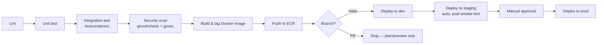
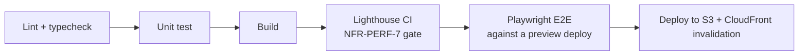

# 15 — CI/CD Pipeline

## 1. Principles

- Green CI is a merge requirement, no exceptions, no `--no-verify` (`00-master-ai-instructions.md §5`).
- Every deploy to staging/prod is traceable to a specific commit and a specific CI run — no manual `docker push`/`terraform apply` from a laptop against staging or prod.
- The monorepo (`13-repository-structure.md`) is path-filtered so a change to one service doesn't rebuild/redeploy all fifteen.

## 2. Monorepo triggers

Each service has its own workflow (`.github/workflows/<service>.yml`) triggered on `push`/`pull_request` with a `paths` filter scoped to `services/<service>/**` and `shared/**` (a shared-code change legitimately should re-verify every consumer). Frontend has its own workflow scoped to `frontend/**`. Terraform has its own workflow scoped to `terraform/**`.

## 3. Per-service pipeline (Go services)

- **Lint**: `golangci-lint run` per `12-coding-standards.md §1.8`.
- **Unit test**: `go test ./... -race -coverprofile=coverage.out`; CI fails if domain/business-logic packages (ledger, fraud rules, EMI calc) fall below the 80% threshold (NFR-MAINT-4).
- **Integration test**: spins up the service's real dependencies via testcontainers (Postgres/Mongo/Redis as applicable — `17-testing-strategy.md §Integration Testing`), not mocks, for anything touching the database.
- **Security scan**: `govulncheck` (known-vulnerable dependencies) and `gosec` (common Go security antipatterns); Critical/High blocks the pipeline (`11-security-standards.md §9`).
- **Build & push**: multi-stage Dockerfile, final image is distroless/Alpine, tagged with the git SHA (and `latest` only for the default branch, never used for an actual deploy reference — deploys always pin to a SHA tag).
- **Deploy**: `aws ecs update-service --force-new-deployment` with the new task definition revision, via a GitHub OIDC-federated role (§6) — no static AWS keys in GitHub Secrets.
- **Smoke test**: a minimal post-deploy check (health endpoint + one representative read call) before traffic is considered verified; staging→prod promotion requires this to pass.

## 4. Frontend pipeline

Lighthouse CI enforces the < 2s load-time NFR as an automated gate, not an occasional manual check.

## 5. Infra pipeline (Terraform)

- `terraform plan` runs on every PR touching `terraform/**`, posting the plan output as a PR comment for review — infra changes are reviewed like code changes, not eyeballed after the fact.
- `terraform apply` for `dev` and `staging` workspaces runs automatically on merge to `main`.
- `terraform apply` for the `prod` workspace requires a manual approval gate (a GitHub Environment with required reviewers) — this is the one pipeline stage in the whole system that always waits for an explicit human click, consistent with `00-master-ai-instructions.md §5.5`.

## 6. Deploy credentials

GitHub Actions authenticates to AWS via OpenID Connect (`aws-actions/configure-aws-credentials` with an IAM role trust policy scoped to the specific GitHub repo/branch), not long-lived access keys. The federated role's permissions are scoped per workflow (the frontend deploy role can touch its S3 bucket and CloudFront distribution; it cannot touch RDS or IAM) — least privilege applies to CI credentials exactly as it does to service runtime credentials (`14-aws-infrastructure.md §8`).

## 7. Database migration gate

- Migrations (`golang-migrate`) run as a distinct CI step before the new task definition is deployed, against the target environment's database, using a dedicated migration-runner IAM role with only `CONNECT` + migration-table privileges, not the application's runtime credentials.
- A migration that fails aborts the deploy before any new code ships — the old task definition keeps serving traffic.
- Migrations are forward-only in staging/prod (`08-database-design.md §15`); a bad migration is fixed with a new migration, and the pipeline enforces "no editing a migration file that has already been applied to staging or prod" via a checksum check.

## 8. Environment promotion model

`dev` (auto on every merge to `main`) → `staging` (auto, gated by smoke test) → `prod` (manual approval, gated by smoke test). Feature branches deploy to ephemeral preview environments only when a PR is explicitly labeled `preview` (cost-conscious — not every PR gets a full stack).

## 9. Rollback strategy

- ECS: redeploying the previous task definition revision (`aws ecs update-service --task-definition <previous-revision>`) is the standard rollback — task definition revisions are immutable and retained, so "roll back" is always a known-good, previously-deployed artifact, never a fresh build.
- Database: no automatic rollback of a migration in staging/prod (§7) — a bad migration is remediated forward. This is a deliberate constraint that pushes toward writing safer migrations (additive, backward-compatible) rather than relying on rollback as a safety net.
- Frontend: CloudFront can be pointed at a previous S3 object version/prefix if a bad build ships; content-hashed assets mean old and new builds coexist safely in the bucket during the switch.

## 10. Traceability

CI gates in this document are the automated enforcement of `12-coding-standards.md` (lint), `17-testing-strategy.md` (test stages/coverage), and `11-security-standards.md` (scans). The environment promotion model implements the manual-approval expectation in `00-master-ai-instructions.md §5.5` for production-affecting changes.
