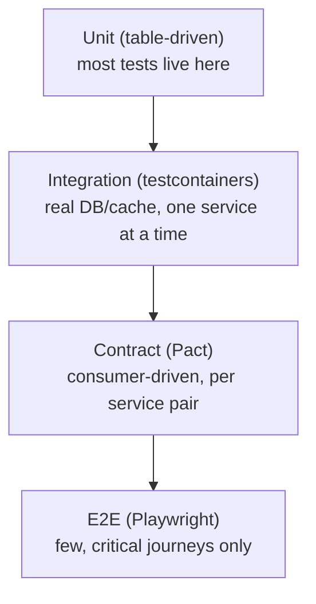

# 17 — Testing Strategy

## 1. Test pyramid

Most coverage lives at the bottom: unit tests are fast, deterministic, and cheap to write, so they carry the weight. Each layer up costs more to write and run and is reserved for what the layer below genuinely cannot verify.

## 2. Unit testing

- Every domain/business-logic package (ledger balancing, EMI amortization, fraud rule evaluation, interest accrual) requires table-driven unit tests (`12-coding-standards.md §1.9`) covering the happy path, boundary conditions (zero amount, exact limit, one-unit-over-limit), and documented error cases.
- Coverage target: ≥80% on `internal/domain` and `internal/service` packages specifically (NFR-MAINT-4) — coverage on `internal/transport` (thin handler glue) is not separately gated, since it's exercised more meaningfully by integration tests.
- Property-based testing is used for the ledger balancing invariant specifically: generate random sets of legs and assert the "sum to zero or reject" property holds, rather than relying solely on hand-picked example cases — this is the one area where example-based tests alone are not convincing enough given how central the invariant is (`04-non-functional-requirements.md §5`).
- Mocking is reserved for genuinely external boundaries (a repository interface, a gRPC client interface) — never mock the thing you're trying to test, and never mock a real database in a test that's supposed to verify a query is correct (that's what integration tests are for, §3).

## 3. Integration testing

- Every service's repository layer and any handler that touches a real datastore is tested against **actual** Postgres/MongoDB/Redis instances via testcontainers — not mocks, and not a shared persistent test database. This is a standing rule with a documented reason: mocked-DB tests have previously (in other projects, and as a general industry lesson) passed while the real query/migration was broken, so this project pays the small extra runtime cost to catch that class of bug before it ships.
- Each test gets a fresh container (or a fresh schema within a shared container instance, for speed) so tests are independent and order-independent.
- Migrations run as part of integration test setup, using the same migration files that ship to staging/prod (`08-database-design.md §15`) — this also incidentally tests that migrations apply cleanly.

## 4. Contract testing

- Pact (consumer-driven contracts) verifies the two classes of cross-service dependency that would otherwise only be caught by a full E2E test or, worse, in staging: the gRPC calls (Payment↔Fraud, Payment↔Transaction, Wallet↔Transaction, Loan↔Payment, Loan↔Fraud) and the event schemas (`09-api-standards.md §4`) each consumer expects from each publisher.
- The consumer writes the contract (what it expects); the provider's CI verifies it can satisfy every registered contract before it's allowed to change its API — this catches a breaking change at the *provider's* PR, before it ever reaches a shared environment, rather than after both services are deployed and something breaks in staging.
- Contracts are stored in a lightweight Pact broker (self-hosted alongside the other Docker Compose infra in dev, or a hosted free tier) — versioned per environment so a provider can check "am I compatible with what's actually deployed in staging" before promoting further.

## 5. End-to-end testing

- Playwright, run against a deployed preview/staging environment (not mocked services) — E2E value comes specifically from exercising the real integrated system.
- Scope is deliberately narrow: the customer journeys that matter most for credibility and correctness —
  1. Register → verify email → complete KYC → open account.
  2. Login → transfer money to another customer → see updated balance and transaction history.
  3. Apply for a loan → get approved → see EMI schedule → make a payment.
  4. Trigger a fraud rule (e.g. rapid transfers) → confirm the transaction is blocked and a case is opened.
  5. Admin: search a customer → freeze an account → confirm it's audited.
- E2E tests are not the place to test every edge case — that's what unit/integration/contract layers are for. E2E answers "does the whole system actually work end to end," not "are all the branches covered."

## 6. Load testing

- k6 scripts target the two paths with explicit NFR budgets: fund transfer (NFR-PERF-3) and the Fraud `CheckTransaction` call (NFR-PERF-4).
- Ledger correctness under load is the specific thing being verified, not just throughput: a load test run asserts that after N concurrent transfers, every account's balance matches the sum of its legs exactly — zero tolerance for drift (NFR-SCALE-2's "no balance-drift" requirement is a load-test assertion, not just an aspiration).
- Load tests run against a dedicated, temporary environment (spun up via the same Terraform modules, torn down after) — never against shared staging, and never against prod.
- Results (throughput, P50/P95/P99 latency, any drift detected) are recorded per run so regressions are visible over time — this doubles as benchmark material for the LinkedIn content strategy (`01-product-vision.md §7`).

## 7. Security testing

- Dependency/container scanning is part of CI (`15-cicd-pipeline.md §3`), not a separate "testing" activity — it's automated and continuous.
- A manual security review pass (using the checklist in `11-security-standards.md §11`) happens at the end of each roadmap phase that introduces new attack surface (a new public endpoint, a new auth flow, a new admin capability) — see `19-implementation-roadmap.md`.

## 8. Test data management

- Seed data scripts (`scripts/seed/`) generate realistic-shaped fake customers/accounts/transactions for local development and demo purposes — no real PII is ever used, even the developer's own, in seed data or fixtures.
- Integration/E2E tests generate their own isolated data per test run (unique emails, account numbers) rather than depending on a shared fixed dataset, so tests can run in parallel and repeatedly without collision.

## 9. Flaky test policy

A flaky test is treated as a bug in the test (or in the code it's testing, if it's revealing a real race condition) — it is fixed or deleted, never silently retried-until-green or marked `skip` and forgotten. A test that's `skip`ped must have a linked follow-up noting why and when it'll be revisited.

## 10. Traceability

Coverage targets here enforce NFR-MAINT-4; load test assertions enforce NFR-SCALE-2 and NFR-DATA-3; the CI stages that run each layer are defined in `15-cicd-pipeline.md §3`. Each service's specific test scenarios trace back to its `FR-*` requirements in `03-functional-requirements.md`.
